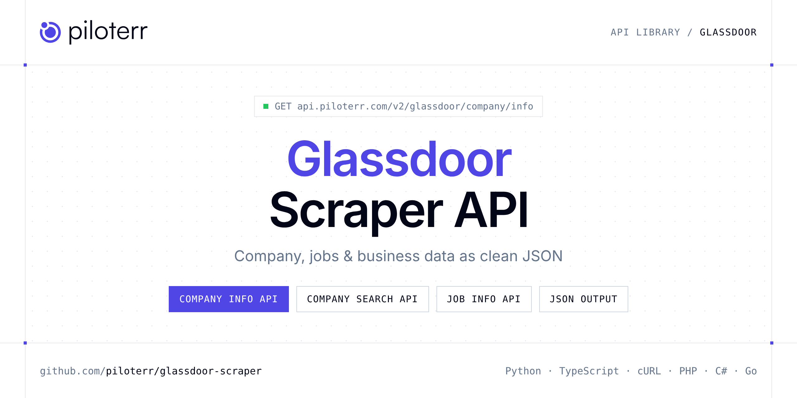

<p align="center">
  <a href="https://www.piloterr.com"></a>
</p>

# Glassdoor Scraper API

[](https://discord.gg/CFj3ph8aHU) [](https://app.piloterr.com) [](https://app.piloterr.com/openapi) [](LICENSE)

The **Piloterr Glassdoor Scraper API** lets you extract public data from Glassdoor as **clean, structured JSON** — no proxies, headless browsers or HTML parsing to maintain. Endpoints available in production:

- **Glassdoor Company Info API** — Get one Glassdoor company profile by URL or employer id (2 credits).
- **Glassdoor Company Search API** — Search Glassdoor employers by keyword across country sites (2 credits).
- **Glassdoor Job Info API** — Get one Glassdoor job listing by URL or jl id (2 credits).
- **Glassdoor Job Search API** — Search Glassdoor jobs by keyword or SEO URL, with domain and filters (2 credits).

Use it for lead generation, CRM enrichment, market mapping, investment research or job market analytics.

| Endpoint | Path | Credits | What you get |
|---|---|---|---|
| [Glassdoor Company Info API](#glassdoor-company-info-api) | `/v2/glassdoor/company/info` | 2 | Get one Glassdoor company profile by URL or employer id (2 credits). |
| [Glassdoor Company Search API](#glassdoor-company-search-api) | `/v2/glassdoor/company/search` | 2 | Search Glassdoor employers by keyword across country sites (2 credits). |
| [Glassdoor Job Info API](#glassdoor-job-info-api) | `/v2/glassdoor/job/info` | 2 | Get one Glassdoor job listing by URL or jl id (2 credits). |
| [Glassdoor Job Search API](#glassdoor-job-search-api) | `/v2/glassdoor/job/search` | 2 | Search Glassdoor jobs by keyword or SEO URL, with domain and filters (2 credits). |

## Table of contents

- [How it works](#how-it-works)
- [Glassdoor Company Info API](#glassdoor-company-info-api)
- [Glassdoor Company Search API](#glassdoor-company-search-api)
- [Glassdoor Job Info API](#glassdoor-job-info-api)
- [Glassdoor Job Search API](#glassdoor-job-search-api)
- [Code examples in other languages](#code-examples-in-other-languages)
- [Practical use cases](#practical-use-cases)
- [Why Piloterr?](#why-piloterr)
- [FAQ](#faq)
- [Related scrapers](#related-scrapers)
- [Support](#support)

## How it works

1. **Create a free Piloterr account** and copy your API key from the [dashboard](https://app.piloterr.com).
2. **Send a `GET` (or `POST`) request** to `https://api.piloterr.com/v2/...` with the header `x-api-key: YOUR_API_KEY`.
3. **Receive structured JSON** — Piloterr handles rendering, proxies, retries and parsing.

```bash
export PILOTERR_API_KEY="your-api-key"
pip install requests        # Python
# TypeScript: Node.js 18+ (native fetch), run with `npx tsx file.ts`
```

> Every endpoint accepts both `GET` (query string) and `POST` (JSON body with the same fields).

## Glassdoor Company Info API

Get one Glassdoor company profile by URL or employer id (2 credits).

`GET | POST https://api.piloterr.com/v2/glassdoor/company/info` · **2 credits per request** · [Full reference](https://app.piloterr.com/openapi)

### Request parameters

| Parameter | Type | Required | Description |
|---|---|---|---|
| `query` | string | ✅ | Company URL or employer id.\n\n**Example:**\n\n 1692882 |
| `domain` | string | — | Glassdoor TLD when query is not a full URL. |

### Python example

```python
import json
import os
import requests

response = requests.get(
    "https://api.piloterr.com/v2/glassdoor/company/info",
    headers={"x-api-key": os.environ["PILOTERR_API_KEY"]},
    params={
        "query": "1692882",
    },
    timeout=60,
)
response.raise_for_status()
data = response.json()

print(json.dumps(data, indent=2, ensure_ascii=False)[:2000])
```

### TypeScript example

```typescript
type GlassdoorCompanyInfo = {
  url?: string;
  name?: string;
  size?: string;
  domain?: string;
  rating?: number;
  founded?: string;
  revenue?: string;
  website?: string;
  industry?: string;
  logo_url?: string;
  description?: string;
  employer_id?: string;
  headquarters?: string;
  review_count?: number;
};

const params = new URLSearchParams({
  "query": "1692882",
});

const response = await fetch(`https://api.piloterr.com/v2/glassdoor/company/info?${params}`, {
  headers: { "x-api-key": process.env.PILOTERR_API_KEY! },
});
if (!response.ok) throw new Error(`Piloterr error ${response.status}: ${await response.text()}`);

const data = (await response.json()) as GlassdoorCompanyInfo;

console.log(JSON.stringify(data, null, 2).slice(0, 2000));
```

<details>
<summary><b>POST variant</b></summary>

```http
POST https://api.piloterr.com/v2/glassdoor/company/info
x-api-key: YOUR_API_KEY
Content-Type: application/json

{"query": "1692882"}
```
</details>

### Output example

Example response from the API reference, abridged — real values depend on the page you scrape.

```json
{
  "url": "https://www.glassdoor.fr/Présentation/Travailler-chez-Scalian-EI_IE1692882.16,23.htm",
  "name": "Scalian",
  "size": "De 5 001 à 10 000 employés",
  "domain": "fr",
  "rating": 3.6,
  "founded": "1989",
  "revenue": "Entre 500 millions et 1 milliard $ (USD)",
  "website": "https://www.scalian.com",
  "industry": "Solutions logicielles et réseau d’entreprise",
  "logo_url": "https://media.glassdoor.com/sql/1692882/scalian-squarelogo-1502869323027.png",
  "description": "Créé en 1989, Scalian est un pure player dans les domaines des logiciels critiques…",
  "employer_id": "1692882",
  "headquarters": "Toulouse, France",
  "review_count": 1099
}
```

### Response fields

| Field | Type | Description |
|---|---|---|
| `url` | string |  |
| `name` | string |  |
| `size` | string |  |
| `domain` | string |  |
| `rating` | number |  |
| `founded` | string |  |
| `revenue` | string |  |
| `website` | string |  |
| `industry` | string |  |
| `logo_url` | string |  |
| `description` | string |  |
| `employer_id` | string |  |
| `headquarters` | string |  |
| `review_count` | integer |  |

## Glassdoor Company Search API

Search Glassdoor employers by keyword across country sites (2 credits).

`GET | POST https://api.piloterr.com/v2/glassdoor/company/search` · **2 credits per request** · [Full reference](https://app.piloterr.com/openapi)

### Request parameters

| Parameter | Type | Required | Description |
|---|---|---|---|
| `query` | string | ✅ | Employer keyword, or a full Glassdoor autocomplete URL.\n\n**Example:**\n\n airbus |
| `domain` | string | — | Glassdoor TLD (`fr`, `com`, `co.uk`, …). |

### Python example

```python
import json
import os
import requests

response = requests.get(
    "https://api.piloterr.com/v2/glassdoor/company/search",
    headers={"x-api-key": os.environ["PILOTERR_API_KEY"]},
    params={
        "query": "airbus",
    },
    timeout=60,
)
response.raise_for_status()
data = response.json()

print(json.dumps(data, indent=2, ensure_ascii=False)[:2000])
```

### TypeScript example

```typescript
type GlassdoorCompanySearch = {
  results?: {
    url?: string;
    name?: string;
    website?: string;
    logo_url?: string;
    short_name?: string;
    employer_id?: string;
  }[];
  pagination?: {
    next?: unknown;
    page?: number;
    per_page?: number;
    total_pages?: unknown;
    total_results?: unknown;
  };
};

const params = new URLSearchParams({
  "query": "airbus",
});

const response = await fetch(`https://api.piloterr.com/v2/glassdoor/company/search?${params}`, {
  headers: { "x-api-key": process.env.PILOTERR_API_KEY! },
});
if (!response.ok) throw new Error(`Piloterr error ${response.status}: ${await response.text()}`);

const data = (await response.json()) as GlassdoorCompanySearch;

console.log(JSON.stringify(data, null, 2).slice(0, 2000));
```

<details>
<summary><b>POST variant</b></summary>

```http
POST https://api.piloterr.com/v2/glassdoor/company/search
x-api-key: YOUR_API_KEY
Content-Type: application/json

{"query": "airbus"}
```
</details>

### Output example

Example response from the API reference, abridged — real values depend on the page you scrape.

```json
{
  "results": [
    {
      "url": "https://www.glassdoor.fr/Présentation/Travailler-chez-Airbus-EI_IE3059.htm",
      "name": "Airbus S.A.S.",
      "website": "www.airbus-group.com",
      "logo_url": "https://media.glassdoor.com/sqlm/3059/airbus-squarelogo-1702511286787.png",
      "short_name": "Airbus",
      "employer_id": "3059"
    }
  ],
  "pagination": {
    "next": null,
    "page": 1,
    "per_page": 12,
    "total_pages": null,
    "total_results": null
  }
}
```

### Response fields

| Field | Type | Description |
|---|---|---|
| `results[]` | object[] |  |
| `results[].url` | string |  |
| `results[].name` | string |  |
| `results[].website` | string |  |
| `results[].logo_url` | string |  |
| `results[].short_name` | string |  |
| `results[].employer_id` | string |  |
| `pagination` | object |  |
| `pagination.next` | object |  |
| `pagination.page` | integer |  |
| `pagination.per_page` | integer |  |
| `pagination.total_pages` | object |  |
| `pagination.total_results` | object |  |

## Glassdoor Job Info API

Get one Glassdoor job listing by URL or jl id (2 credits).

`GET | POST https://api.piloterr.com/v2/glassdoor/job/info` · **2 credits per request** · [Full reference](https://app.piloterr.com/openapi)

### Request parameters

| Parameter | Type | Required | Description |
|---|---|---|---|
| `query` | string | ✅ | Job listing URL or jl id.\n\n**Example:**\n\n 1010283388161 |
| `domain` | string | — | Glassdoor TLD when query is not a full URL. |

### Python example

```python
import json
import os
import requests

response = requests.get(
    "https://api.piloterr.com/v2/glassdoor/job/info",
    headers={"x-api-key": os.environ["PILOTERR_API_KEY"]},
    params={
        "query": "1010283388161",
    },
    timeout=60,
)
response.raise_for_status()
data = response.json()

print(json.dumps(data, indent=2, ensure_ascii=False)[:2000])
```

### TypeScript example

```typescript
type GlassdoorJobInfo = {
  url?: string;
  title?: string;
  domain?: string;
  salary?: unknown;
  company?: string;
  location?: string;
  logo_url?: string;
  company_url?: string;
  date_posted?: string;
  description?: string;
  job_listing_id?: string;
  employment_type?: string[];
};

const params = new URLSearchParams({
  "query": "1010283388161",
});

const response = await fetch(`https://api.piloterr.com/v2/glassdoor/job/info?${params}`, {
  headers: { "x-api-key": process.env.PILOTERR_API_KEY! },
});
if (!response.ok) throw new Error(`Piloterr error ${response.status}: ${await response.text()}`);

const data = (await response.json()) as GlassdoorJobInfo;

console.log(JSON.stringify(data, null, 2).slice(0, 2000));
```

<details>
<summary><b>POST variant</b></summary>

```http
POST https://api.piloterr.com/v2/glassdoor/job/info
x-api-key: YOUR_API_KEY
Content-Type: application/json

{"query": "1010283388161"}
```
</details>

### Output example

Example response from the API reference, abridged — real values depend on the page you scrape.

```json
{
  "url": "https://www.glassdoor.fr/job-listing/stage-devops-docker-kubernetes-et-ci-cd-niveau-bac-34-it-systèmes-d-information-la-defense-ile-de-fr…",
  "title": "Stage DevOps - Docker, Kubernetes et CI/CD (niveau bac +3/4) - IT (Systèmes d'information) - La Defense, Ile de France, France",
  "domain": "fr",
  "salary": null,
  "company": "SOCIETE GENERALE",
  "location": "Paris, Île-de-France, France",
  "logo_url": "https://media.glassdoor.com/sql/10350/société-générale-squareLogo-1625070831989.png",
  "company_url": "https://www.glassdoor.fr/Présentation/Travailler-chez-Société-Générale-EI_IE10350.16,32.htm",
  "date_posted": "2026-10-02T00:00:00",
  "description": "<div><b>Vos missions au quotidien</b>…</div>",
  "job_listing_id": "1010283388161",
  "employment_type": [
    "FULL_TIME"
  ]
}
```

### Response fields

| Field | Type | Description |
|---|---|---|
| `url` | string |  |
| `title` | string |  |
| `domain` | string |  |
| `salary` | object |  |
| `company` | string |  |
| `location` | string |  |
| `logo_url` | string |  |
| `company_url` | string |  |
| `date_posted` | string |  |
| `description` | string |  |
| `job_listing_id` | string |  |
| `employment_type` | string[] |  |

## Glassdoor Job Search API

Search Glassdoor jobs by keyword or SEO URL, with domain and filters (2 credits).

`GET | POST https://api.piloterr.com/v2/glassdoor/job/search` · **2 credits per request** · [Full reference](https://app.piloterr.com/openapi)

### Request parameters

| Parameter | Type | Required | Description |
|---|---|---|---|
| `query` | string | ✅ | Keyword or full Glassdoor job search URL. |
| `domain` | string | — | Glassdoor TLD when query is not a full URL. |
| `page` | number | — | Page number. |
| `sort_by` | string | — | Glassdoor sortBy value (e.g. date_desc). |
| `remote` | boolean | — | When true, set remoteWorkType=1. |

### Python example

```python
import json
import os
import requests

response = requests.get(
    "https://api.piloterr.com/v2/glassdoor/job/search",
    headers={"x-api-key": os.environ["PILOTERR_API_KEY"]},
    params={
        "query": "security",
    },
    timeout=60,
)
response.raise_for_status()
data = response.json()

print(json.dumps(data, indent=2, ensure_ascii=False)[:2000])
```

### TypeScript example

```typescript
type GlassdoorJobSearch = {
  results?: {
    age?: string;
    url?: string;
    title?: string;
    salary?: unknown;
    company?: string;
    summary?: string;
    location?: string;
    logo_url?: string;
    job_listing_id?: string;
  }[];
  pagination?: {
    next?: string;
    page?: number;
    per_page?: number;
    total_pages?: unknown;
    total_results?: unknown;
  };
};

const params = new URLSearchParams({
  "query": "security",
});

const response = await fetch(`https://api.piloterr.com/v2/glassdoor/job/search?${params}`, {
  headers: { "x-api-key": process.env.PILOTERR_API_KEY! },
});
if (!response.ok) throw new Error(`Piloterr error ${response.status}: ${await response.text()}`);

const data = (await response.json()) as GlassdoorJobSearch;

console.log(JSON.stringify(data, null, 2).slice(0, 2000));
```

<details>
<summary><b>POST variant</b></summary>

```http
POST https://api.piloterr.com/v2/glassdoor/job/search
x-api-key: YOUR_API_KEY
Content-Type: application/json

{"query": "security"}
```
</details>

### Output example

Example response from the API reference, abridged — real values depend on the page you scrape.

```json
{
  "results": [
    {
      "age": "30j+",
      "url": "https://www.glassdoor.fr/job-listing/ingénieur-e-expérimenté-e-soc-cert-automotive-hf-cybersécurité-ile-de-france-sopra-steria-JV_IC43374…",
      "title": "Ingénieur(e) expérimenté(e) SOC/CERT Automotive (H/F) - Cybersécurité - Ile de France",
      "salary": null,
      "company": "Sopra Steria",
      "summary": "Vous interviendrez pour l'un de nos clients majeurs dans le secteur de l'automobile…",
      "location": "Courbevoie",
      "logo_url": "https://media.glassdoor.com/sql/466295/sopra-steria-squareLogo-1612703737891.png",
      "job_listing_id": "1010044566651"
    }
  ],
  "pagination": {
    "next": "https://www.glassdoor.fr/Emploi/paris-information-security-analyst-emplois-SRCH_IL.0,5_IC2881970_KO6,34.htm?page=2",
    "page": 1,
    "per_page": 30,
    "total_pages": null,
    "total_results": null
  }
}
```

### Response fields

| Field | Type | Description |
|---|---|---|
| `results[]` | object[] |  |
| `results[].age` | string |  |
| `results[].url` | string |  |
| `results[].title` | string |  |
| `results[].salary` | object |  |
| `results[].company` | string |  |
| `results[].summary` | string |  |
| `results[].location` | string |  |
| `results[].logo_url` | string |  |
| `results[].job_listing_id` | string |  |
| `pagination` | object |  |
| `pagination.next` | string |  |
| `pagination.page` | integer |  |
| `pagination.per_page` | integer |  |
| `pagination.total_pages` | object |  |
| `pagination.total_results` | object |  |

## Code examples in other languages

Ready-to-run examples live in the [`examples/`](examples) folder. Each one reads your key from the `PILOTERR_API_KEY` environment variable.

| Language | Company Info | Company Search | Job Info | Job Search |
|---|---|---|---|---|
| cURL (Bash) | [`company-info`](examples/curl/company_info.sh) | [`company-search`](examples/curl/company_search.sh) | [`job-info`](examples/curl/job_info.sh) | [`job-search`](examples/curl/job_search.sh) |
| PHP | [`company-info`](examples/php/company_info.php) | [`company-search`](examples/php/company_search.php) | [`job-info`](examples/php/job_info.php) | [`job-search`](examples/php/job_search.php) |
| C# | [`company-info`](examples/csharp/CompanyInfo.cs) | [`company-search`](examples/csharp/CompanySearch.cs) | [`job-info`](examples/csharp/JobInfo.cs) | [`job-search`](examples/csharp/JobSearch.cs) |
| Go | [`company-info`](examples/go/company_info.go) | [`company-search`](examples/go/company_search.go) | [`job-info`](examples/go/job_info.go) | [`job-search`](examples/go/job_search.go) |
| Java | [`company-info`](examples/java/CompanyInfoExample.java) | [`company-search`](examples/java/CompanySearchExample.java) | [`job-info`](examples/java/JobInfoExample.java) | [`job-search`](examples/java/JobSearchExample.java) |
| Ruby | [`company-info`](examples/ruby/company_info.rb) | [`company-search`](examples/ruby/company_search.rb) | [`job-info`](examples/ruby/job_info.rb) | [`job-search`](examples/ruby/job_search.rb) |
| Node.js | [`company-info`](examples/nodejs/company_info.mjs) | [`company-search`](examples/nodejs/company_search.mjs) | [`job-info`](examples/nodejs/job_info.mjs) | [`job-search`](examples/nodejs/job_search.mjs) |

## Practical use cases

- **Lead generation** — Build target account lists from public company data.
- **CRM enrichment** — Keep firmographics, websites and descriptions up to date.
- **Market mapping** — Map competitors and segments across countries and industries.
- **Investment research** — Screen companies, funding and signals for deal flow.
- **Job market analytics** — Track hiring, roles and salaries where available.

## Why Piloterr?

- **No infrastructure** — no proxies, headless browsers or CAPTCHA solving to run yourself.
- **Structured JSON** — stable, documented fields instead of brittle HTML selectors.
- **Pay per request** — transparent credit cost per endpoint, failed requests are retried for you.
- **One API key, hundreds of sources** — Glassdoor plus many other e-commerce, search and company data endpoints in the [Piloterr library](https://www.piloterr.com/library).
- **Any language** — plain HTTPS + JSON, with examples for Python, TypeScript, cURL, PHP, C#, Go, Java, Ruby and Node.js.

## FAQ

### Is it legal to scrape Glassdoor?

Collecting publicly available data is generally allowed in many jurisdictions, but rules depend on your country, the data you collect and how you use it. Avoid personal data unless you have a lawful basis, respect the website's terms where they apply, and get legal advice for your specific use case. This is not legal advice.

### Do I need proxies or a headless browser?

No. Piloterr handles rendering, proxy rotation and retries on its side. You only send an HTTPS request with your `x-api-key` header and receive JSON.

### How much does a request cost?

Credits per call: `/v2/glassdoor/company/info` **2**, `/v2/glassdoor/company/search` **2**, `/v2/glassdoor/job/info` **2**, `/v2/glassdoor/job/search` **2**. See the [Piloterr website](https://www.piloterr.com) for plans.

### What data does the Glassdoor API return?

Each endpoint returns structured JSON: **Glassdoor Company Info** — `url`, `name`, `size`, `domain`, `rating`, `founded`; **Glassdoor Company Search** — `results[]`, `results[].url`, `results[].name`, `results[].website`, `results[].logo_url`, `results[].short_name`; **Glassdoor Job Info** — `url`, `title`, `domain`, `salary`, `company`, `location`; **Glassdoor Job Search** — `results[]`, `results[].age`, `results[].url`, `results[].title`, `results[].salary`, `results[].company`.

### How do I paginate Glassdoor results?

Use the `page` parameter and keep requesting while the response indicates more results.

### Can I target a specific country or language?

Yes, use `domain` — see the parameter tables above for accepted values.

### Which languages are supported?

Any language that can make an HTTP request. This README shows Python and TypeScript; the [`examples/`](examples) folder contains cURL, PHP, C#, Go, Java, Ruby and Node.js.

## Related scrapers

- [Company Database Scraper API](https://github.com/piloterr/company-data-api)
- [Crunchbase Scraper API](https://github.com/piloterr/crunchbase-scraper)
- [Europages Scraper API](https://github.com/piloterr/europages-scraper)
- [Fiverr Scraper API](https://github.com/piloterr/fiverr-scraper)
- [G2 Scraper API](https://github.com/piloterr/g2-scraper)
- [github-scraper](https://github.com/piloterr/github-scraper)
- [All Piloterr scrapers on GitHub](https://github.com/piloterr)

## Support

- 💬 Join the [Piloterr Discord](https://discord.gg/CFj3ph8aHU) to ask questions and share what you build.
- 📚 Browse the [API reference (OpenAPI)](https://app.piloterr.com/openapi) and the [Piloterr library](https://www.piloterr.com/library).
- 🔑 [Get your API key](https://app.piloterr.com).

---

<p align="center">
  <a href="https://www.piloterr.com">
    <picture>
      <source media="(prefers-color-scheme: dark)" srcset="images/logo-dark.svg">
      
    </picture>
  </a>
  <br>
  <sub>Built by <a href="https://www.piloterr.com">Piloterr</a> — web scraping APIs for e-commerce, search, real estate and more, one API key.</sub>
</p>

<sub>Glassdoor is a trademark of its respective owner. This repository is not affiliated with or endorsed by Glassdoor. Examples are released under the MIT license.</sub>
